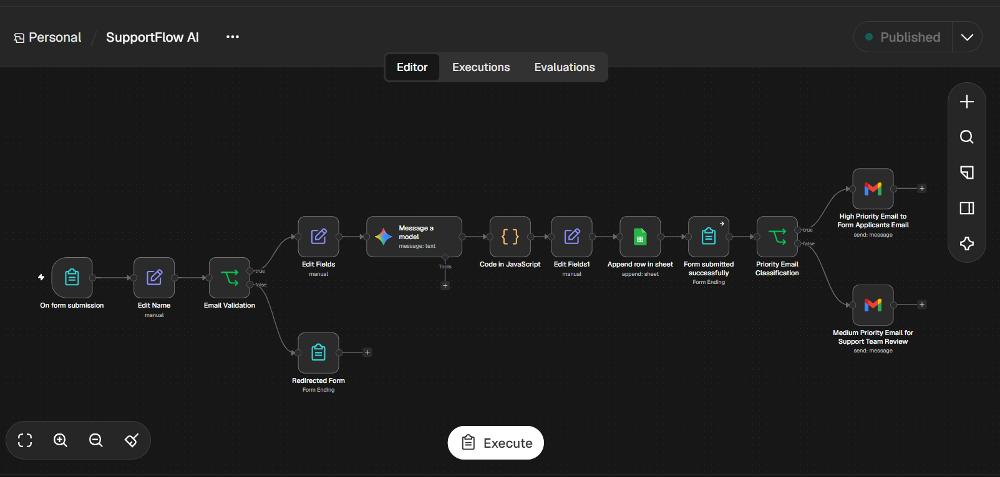
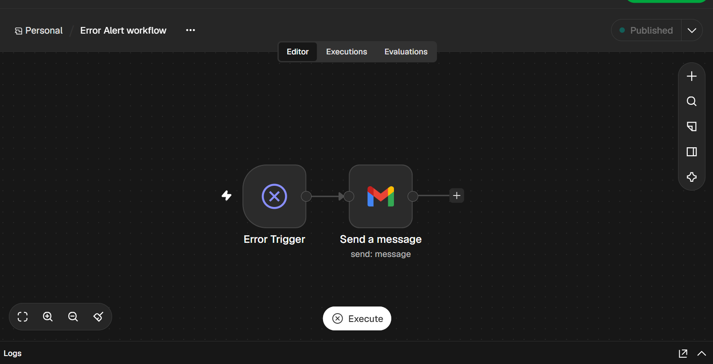

# SupportFlow AI

**A smarter way to handle incoming support tickets.**

SupportFlow AI is an n8n project that helps organize support requests from the moment they come in. It checks the sender’s email address, asks Google Gemini to suggest a ticket category and priority, saves the results in Google Sheets, and routes email notifications through Gmail.

The goal is to make incoming requests easier to review and prioritize, while keeping a person in control of the final support decision.

## How it works

1. A support ticket enters the workflow.
2. The workflow checks that the email address is valid.
3. Google Gemini suggests a category and priority for the ticket.
4. The ticket details and classification are recorded in Google Sheets.
5. Gmail sends a notification based on the routing logic.
6. Global error handling helps manage workflow failures.

## Error handling

A separate n8n workflow listens for workflow errors and sends an alert through Gmail.

## Built with

- **n8n** for connecting and automating the steps
- **Google Gemini** for ticket classification
- **Google Sheets** for keeping ticket records
- **Gmail** for email notifications
- 
## Project files

- [Workflow overview](docs/workflow-overview.md)
- [Main n8n workflow](workflow/SupportFlow%20main.json)
- [Error-alert workflow](workflow/Erroralert-workflow.json)
- [Main workflow screenshot](screenshots/supportflow-workflow.png)
- [Error-alert screenshot](screenshots/supportflow-error-workflow.png)
  
## About this project
SupportFlow AI is a portfolio project exploring how AI and automation can support customer service. This repository includes the two n8n workflow exports, an overview, and screenshots.
## Privacy and security

This is a public repository. It should contain no API keys, login details, private email addresses, customer information, or real support tickets. Keep integration credentials in n8n, and use fictional data in any examples or screenshots.

## A note on AI

Gemini’s category and priority are suggestions. A person should review them before acting on a ticket.
